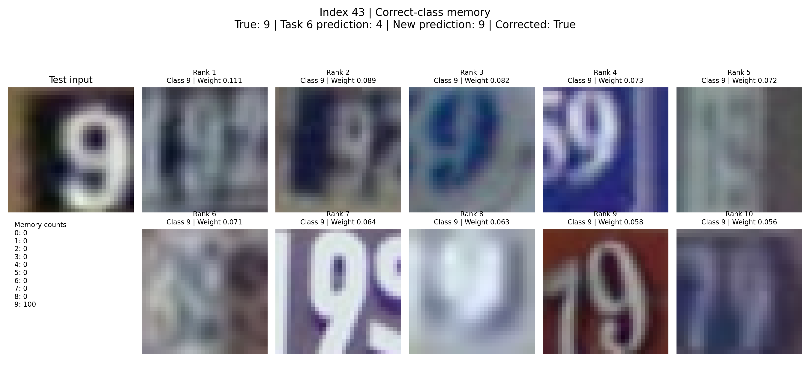
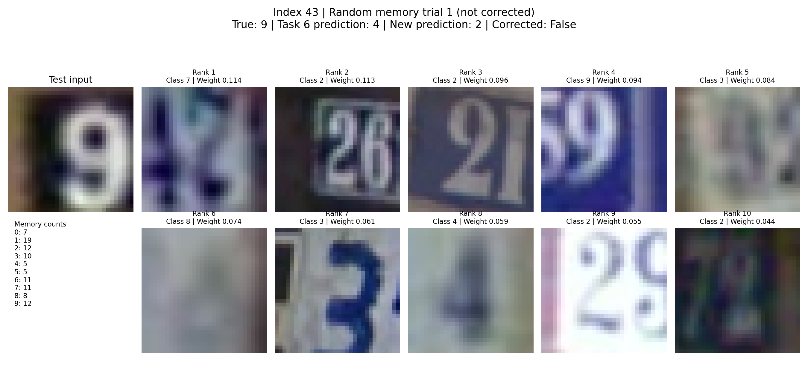
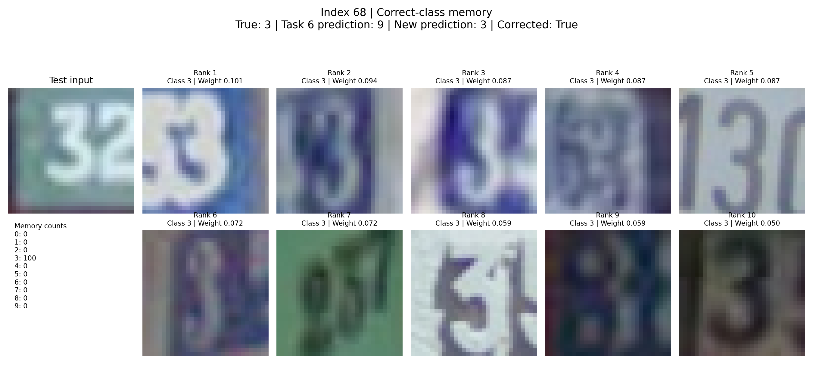
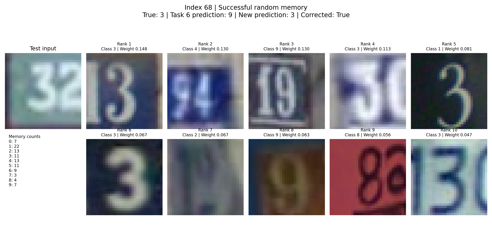
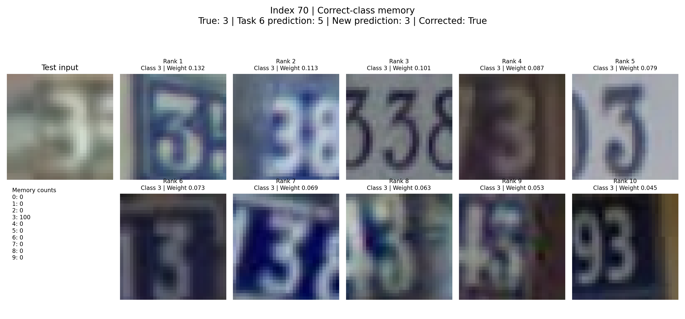
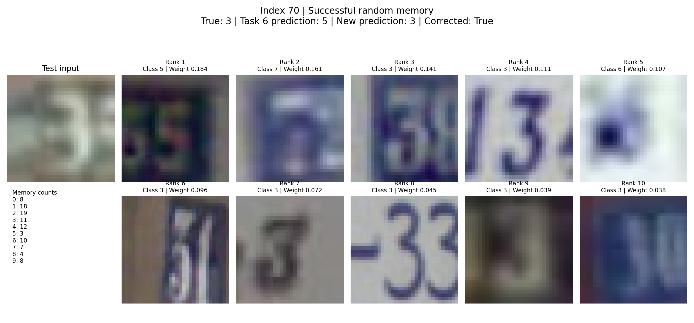

# Task 7: Memory Impact Analysis

## Experimental setup

I analyzed the same 20 incorrectly predicted SVHN test inputs selected
during Task 6. The pretrained checkpoint used MobileNet with the
`encoder_memory` Memory Wrap modality and was trained using 2,000
training examples.

For every selected input, I first replaced the original mixed memory
with a memory set containing 100 training samples belonging only to the
input's true class.

I then searched up to 100 reproducible random memory sets per input.
Each random set contained 100 samples selected from the complete
training subset. The search stopped early when a memory set changed the
prediction to the true class.

The random experiment evaluated 1,802 memory sets in total. Eighteen
inputs used all 100 trials, while two inputs were corrected on their
first trial.

## Correct-class memory results

Correct-class memory corrected 3 of the 20 predictions, or 15%.

The corrected inputs were:

- Index 43: true class 9, original prediction 4
- Index 68: true class 3, original prediction 9
- Index 70: true class 3, original prediction 5

The remaining 17 inputs were still incorrect even though every memory
sample belonged to the true class. Therefore, filling the memory with
correctly labeled examples does not guarantee that the full Memory Wrap
model will produce that class.

## Random-memory results

Random memory corrected 2 of the 20 predictions, or 10%, within the
100-trial limit.

The corrected inputs were:

- Index 68: true class 3
- Index 70: true class 3

Both were corrected by the first random memory set tested. No correcting
random set was found for the other 18 inputs within 100 trials. This
does not prove that those inputs can never be corrected; it only means
that they were not corrected within the experiment's search limit.

## Example: index 43

Index 43 has true class 9 and was originally predicted as class 4.

The correct-class memory contained 100 examples of class 9. Its ten
most positively weighted samples were consequently all class 9, and the
new prediction became class 9.

In comparison, the first random memory set contained a mixture of
classes. Its most influential samples included classes 7, 2, 3, 8, and
4. The resulting prediction was class 2 rather than the correct class
9.

This example clearly demonstrates that changing the memory can change
both the explanation and prediction. However, none of the 100 random
sets tested for index 43 corrected it, while the fully class-9 memory
did.

## Example: index 68

Index 68 has true class 3 and was originally predicted as class 9.

A memory containing 100 class-3 samples changed the prediction to class
3. All ten of the most positively weighted memory examples were class
3.

A random memory set also corrected this input. Only 11 of its 100
samples were class 3, so the complete memory was not dominated by the
true class. However, 4 of its 10 most positively weighted samples were
class 3.

This suggests that the overall class distribution may matter less than
which individual samples receive high positive weights. Visual
similarity and the interaction between the input and specific memory
examples may be more important than simply having a majority of the
correct class.

## Example: index 70

Index 70 has true class 3 and was originally predicted as class 5.

Both correct-class memory and the first random memory set changed its
prediction to class 3.

The successful random memory contained only 11 class-3 samples among
its 100 samples. Nevertheless, 7 of its 10 most positively weighted
samples were class 3.

This is the clearest observed example of the model concentrating its
positive weights on relevant correct-class memories, even though the
full random memory set contained many other classes.

## Overall observations

Changing the memory sometimes changed the prediction and always had the
potential to change the explanation because a different collection of
memory examples received positive weights.

However, memory changes had limited corrective power in this
experiment. Correct-class memory corrected only 3 of 20 inputs, and
random memory corrected only 2 of 20.

The tested checkpoint uses the `encoder_memory` modality. This model
combines information from the input encoding with information from the
memory encoding. Therefore, an incorrect or ambiguous input
representation may remain influential even when the memory strongly
supports the true class.

In contrast, the baseline `memory` model uses only the memory-based
representation for classification. I would expect that version to be
more sensitive to changes in the memory set. This is a hypothesis based
on the architectural difference; this experiment tested only the
`encoder_memory` checkpoint.

## Limitations

The random search was limited to 100 sets per input. Additional trials
could potentially find correcting sets for some unresolved inputs.

Only one deterministic correct-class memory set was tested for each
class. Different selections of 100 correct-class examples may produce
different results.

The experiment examined one pretrained `encoder_memory` checkpoint.
Results may differ across checkpoints, model architectures, datasets,
or the baseline-memory modality.